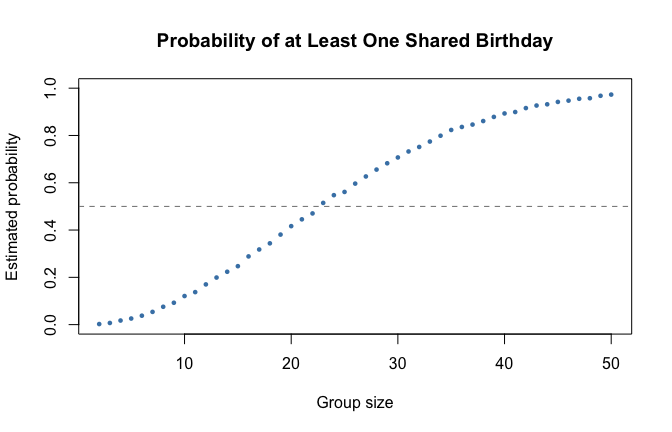
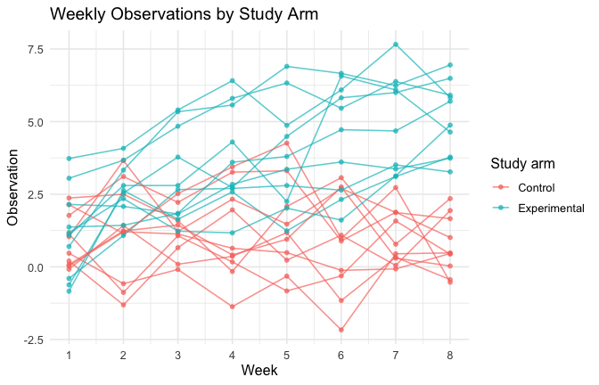
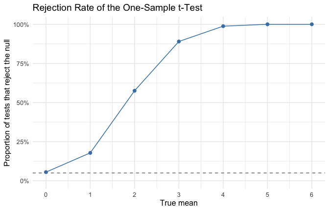
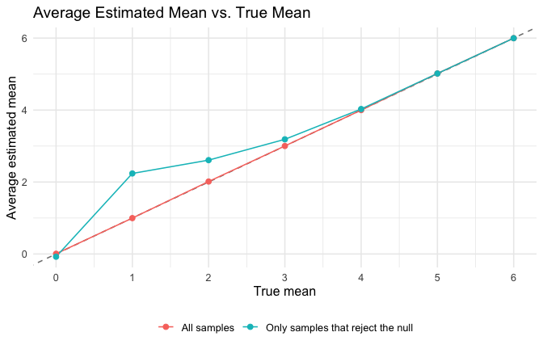

P8105 Homework 5
================

## Problem 1

``` r
set.seed(8105)

has_shared_birthday <- function(group_size) {
  birthdays <- sample(1:365, size = group_size, replace = TRUE)
  any(duplicated(birthdays))
}

group_sizes <- 2:50
n_simulations <- 10000

birthday_results <- data.frame(
  group_size = group_sizes,
  probability = vapply(
    group_sizes,
    function(group_size) {
      mean(replicate(n_simulations, has_shared_birthday(group_size)))
    },
    numeric(1)
  )
)

plot(
  birthday_results$group_size,
  birthday_results$probability,
  type = "b",
  pch = 16,
  cex = 0.65,
  col = "steelblue",
  ylim = c(0, 1),
  xlab = "Group size",
  ylab = "Estimated probability",
  main = "Probability of at Least One Shared Birthday"
)
abline(h = 0.5, lty = 2, col = "gray50")
```

<!-- -->

The estimated probability of at least one shared birthday increases with
group size. At 23 people, the probability is approximately 51.5%. By 50
people, it reaches approximately 97.3%. Larger groups have more pairs of
people who could share a birthday.

## Problem 2

``` r
library(dplyr)
library(tidyr)
library(readr)
library(ggplot2)

longitudinal_data <- tibble(
  file_path = list.files(
    "data",
    pattern = "^(con|exp)_[0-9]+\\.csv$",
    full.names = TRUE
  )
) |>
  mutate(
    file_name = tools::file_path_sans_ext(basename(file_path)),
    measurements = purrr::map(
      file_path,
      read_csv,
      show_col_types = FALSE
    )
  ) |>
  select(file_name, measurements) |>
  separate_wider_delim(
    file_name,
    delim = "_",
    names = c("arm", "subject_id")
  ) |>
  unnest(measurements) |>
  pivot_longer(
    cols = starts_with("week_"),
    names_to = "week",
    names_prefix = "week_",
    names_transform = list(week = as.integer),
    values_to = "observation"
  ) |>
  mutate(
    arm = recode(arm, con = "Control", exp = "Experimental")
  ) |>
  arrange(arm, subject_id, week)

knitr::kable(head(longitudinal_data))
```

| arm     | subject_id | week | observation |
|:--------|:-----------|-----:|------------:|
| Control | 01         |    1 |        0.20 |
| Control | 01         |    2 |       -1.31 |
| Control | 01         |    3 |        0.66 |
| Control | 01         |    4 |        1.96 |
| Control | 01         |    5 |        0.23 |
| Control | 01         |    6 |        1.09 |

``` r
ggplot(
  longitudinal_data,
  aes(
    x = week,
    y = observation,
    color = arm,
    group = interaction(arm, subject_id)
  )
) +
  geom_line(alpha = 0.7) +
  geom_point(size = 1.3, alpha = 0.7) +
  scale_x_continuous(breaks = sort(unique(longitudinal_data$week))) +
  labs(
    title = "Weekly Observations by Study Arm",
    x = "Week",
    y = "Observation",
    color = "Study arm"
  ) +
  theme_minimal(base_size = 12)
```

<!-- -->

Observations overlapped between the two arms in the first week. Over
time, observations generally increased in the experimental arm, while
those in the control arm fluctuated without a clear upward trend. The
groups separated more clearly in the later weeks, with experimental
participants generally showing higher observations.

## Problem 3

``` r
set.seed(8106)

simulate_t_test <- function(true_mu) {
  x <- rnorm(n = 30, mean = true_mu, sd = 5)

  t.test(x, mu = 0, alternative = "two.sided") |>
    broom::tidy() |>
    select(estimate, p.value)
}

t_test_results <- expand_grid(
  true_mu = 0:6,
  simulation = seq_len(5000)
) |>
  mutate(test_result = purrr::map(true_mu, simulate_t_test)) |>
  unnest(test_result) |>
  mutate(rejected = p.value < 0.05)

t_test_summary <- t_test_results |>
  group_by(true_mu) |>
  summarize(
    rejection_rate = mean(rejected),
    mean_estimate = mean(estimate),
    mean_estimate_rejected = mean(estimate[rejected]),
    .groups = "drop"
  )
```

``` r
ggplot(t_test_summary, aes(x = true_mu, y = rejection_rate)) +
  geom_hline(yintercept = 0.05, linetype = "dashed", color = "gray50") +
  geom_line(color = "steelblue") +
  geom_point(color = "steelblue", size = 2) +
  scale_x_continuous(breaks = 0:6) +
  scale_y_continuous(
    limits = c(0, 1),
    labels = scales::label_percent()
  ) +
  labs(
    title = "Rejection Rate of the One-Sample t-Test",
    x = "True mean",
    y = "Proportion of tests that reject the null"
  ) +
  theme_minimal(base_size = 12)
```

<!-- -->

When the true mean is zero, the estimated rejection rate is 5.5%, close
to the nominal 5% Type I error rate. For positive true means, power
increases as the true mean moves farther from zero, approaching 100% at
the largest effect sizes.

``` r
estimate_plot_data <- t_test_summary |>
  transmute(
    true_mu,
    `All samples` = mean_estimate,
    `Only samples that reject the null` = mean_estimate_rejected
  ) |>
  pivot_longer(
    cols = -true_mu,
    names_to = "sample_set",
    values_to = "average_estimate"
  )

ggplot(
  estimate_plot_data,
  aes(x = true_mu, y = average_estimate, color = sample_set)
) +
  geom_abline(
    intercept = 0,
    slope = 1,
    linetype = "dashed",
    color = "gray50"
  ) +
  geom_line() +
  geom_point(size = 2) +
  scale_x_continuous(breaks = 0:6) +
  labs(
    title = "Average Estimated Mean vs. True Mean",
    x = "True mean",
    y = "Average estimated mean",
    color = NULL
  ) +
  theme_minimal(base_size = 12) +
  theme(legend.position = "bottom")
```

<!-- -->

Across all simulated samples, the average estimated mean is close to the
true mean. When the true mean is small and positive, averaging only the
samples that reject the null tends to overestimate it. These samples are
more likely to have estimates that are unusually high. As the true mean
increases, nearly all tests reject the null, so the two averages
converge. At a true mean of zero, the two-sided test selects extreme
estimates in both directions, so their average can still be close to
zero.
